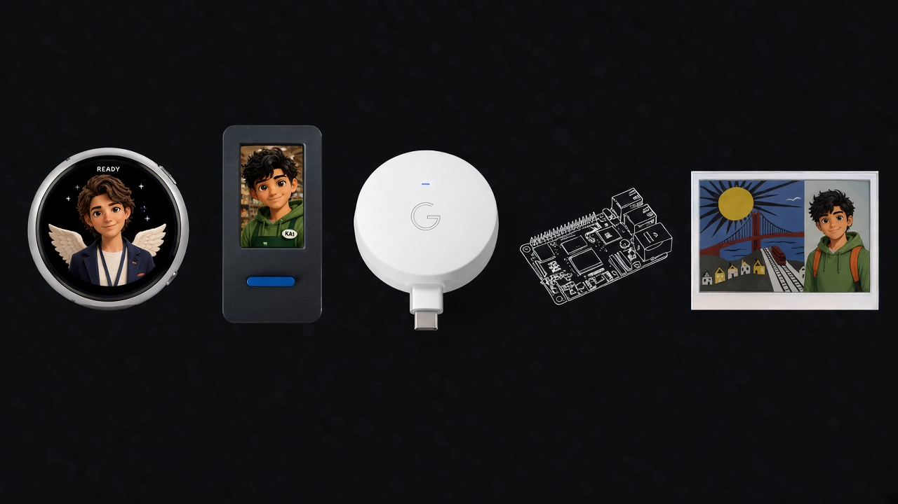
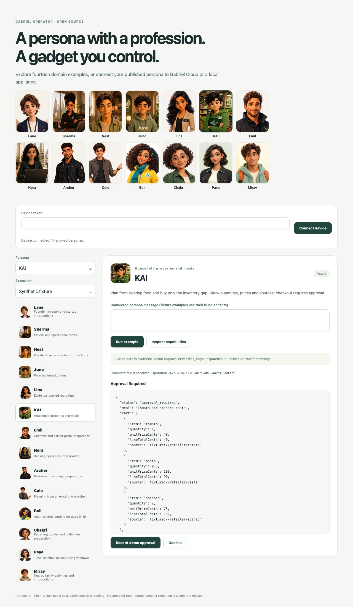

# Gabriel Personas Gadget SDK

Bring a Gabriel AI persona to hardware you control. This Apache-2.0 repository
contains a Python device SDK, a Linux bridge, a browser simulator, ESP32-S3
firmware, and **14 reproducible persona example packages**.

Run synthetic examples without an account, or connect a published persona to
**Gabriel Cloud** or a **private LAN Portable Runtime appliance**. The same
device protocol handles all three choices. Provider credentials stay on the
bridge; hardware receives its own revocable, persona-limited device credential.

The examples demonstrate domain work and review boundaries. They are synthetic
hardware examples, not exports of the production personas. The fixture engine
does not run an LLM. An independently buildable open-source persona runtime is
a separate release commitment; this repository does not publish Gabriel's
private execution backend or redistribute model weights.



The same device protocol can drive a round display, a handheld, a desk puck, an
ESP32-S3 board, or an e-ink frame. Screens in the picture use the official
portraits for Lane, KAI, and Mirav.

## Try the first three examples

Python 3.10+ is sufficient. No runtime dependencies or model downloads are needed.

```sh
git clone https://github.com/Gabriel-Operator/gabriel-personas-gadget-sdk.git
cd gabriel-personas-gadget-sdk
PYTHONPATH=src python3 -m gabriel_gadget demo boli
PYTHONPATH=src python3 -m gabriel_gadget demo kai
PYTHONPATH=src python3 -m gabriel_gadget demo chakri
PYTHONPATH=src python3 -m gabriel_gadget validate
```

For an installed CLI:

```sh
python3 -m venv .venv
.venv/bin/python -m pip install .
.venv/bin/gabriel-gadget demo --all
```

## Meet the fourteen personas

<p>
<a href="examples/personas/lane"></a>
<a href="examples/personas/sherma"></a>
<a href="examples/personas/nest"></a>
<a href="examples/personas/juno"></a>
<a href="examples/personas/lina"></a>
<a href="examples/personas/kai"></a>
<a href="examples/personas/emil"></a>
<a href="examples/personas/nora"></a>
<a href="examples/personas/archer"></a>
<a href="examples/personas/cole"></a>
<a href="examples/personas/boli"></a>
<a href="examples/personas/chakri"></a>
<a href="examples/personas/paya"></a>
<a href="examples/personas/mirav"></a>
</p>

| Persona | Reproducible domain example | Boundary demonstrated |
| --- | --- | --- |
| [Lane](examples/personas/lane) | Evidence-backed company discovery | Review before introductions |
| [Sherma](examples/personas/sherma) | Form twin and missing fields | No live submission |
| [Nest](examples/personas/nest) | One qualified home introduction | Private details withheld |
| [Juno](examples/personas/juno) | Shared-value introduction | Mutual consent required |
| [Lina](examples/personas/lina) | Evidenced skills and outreach draft | No invented skills or sent outreach |
| [KAI](examples/personas/kai) | Pantry gap and cited restock cart | Checkout waits for review |
| [Emil](examples/personas/emil) | Shipment document/portal rehearsal | Licensed declarant remains responsible |
| [Nora](examples/personas/nora) | Bank policy exception review | No money moved |
| [Archer](examples/personas/archer) | Source-backed restaurant brief | No invented generated images or publication |
| [Cole](examples/personas/cole) | Outfit from an owned closet | No reflex purchase |
| [Boli](examples/personas/boli) | Guided circuit observations | Adult review; no fabricated mastery |
| [Chakri](examples/personas/chakri) | Rate-card quote and pickup proposal | Accepted weight and settlement remain reviewed |
| [Paya](examples/personas/paya) | Expiring offer and budget check | Changed plan invalidates approval |
| [Mirav](examples/personas/mirav) | Activity inside an enabled radius | Location privacy and mutual consent |

Each package contains an authored chat configuration, portable example ontology,
synthetic facts, complete expected output, scenario checks, a demo playbook,
the official portrait, an original SVG badge, and setup instructions. The source packages and installed
package data are checked for exact parity. Prices, participants and `fixture://`
sources are explicitly synthetic.

## Use the browser simulator or Linux device client

Enroll a device from the bridge host. The token is saved to a private file and
never printed:

```sh
PYTHONPATH=src python3 -m gabriel_gadget enroll desk \
  --personas boli,kai,chakri,lane,sherma,nest,juno,lina,emil,nora,archer,cole,paya,mirav \
  --token-file .state/desk.token
PYTHONPATH=src python3 -m gabriel_gadget serve
```

Open [the simulator](http://127.0.0.1:8765), paste the contents of your private
device credential file into the masked field, and connect. The credential stays
in page memory. Choose a persona and run the bundled example; inspect the complete
result before recording a clearly labeled **demo approval**.



From another terminal:

```sh
PYTHONPATH=src python3 -m gabriel_gadget chat kai \
  --token-file .state/desk.token --loopback-dev
```

Loopback HTTP is an explicit development convenience. A LAN bridge requires
trusted TLS certificates; firmware always requires HTTPS. See
[Linux setup](linux/README.md) and [device protocol](docs/protocol.md).

## Connect Gabriel Cloud or a local appliance

Copy `backends.example.json` to your private configuration. Set the expected
published persona ID and the **environment variable name** for its persona-scoped
token. Supply the token to the bridge environment, never in the configuration
file, browser, firmware or Git. Use `--config backends.json` when starting the bridge.

The local profile uses a trusted private HTTPS origin and the appliance's own
persona credentials. There is no fallback from local to cloud. Existing published
personas may be bound directly; adding a package does not automatically publish
a persona or deploy a signed bundle.

```sh
PYTHONPATH=src python3 -m gabriel_gadget serve --config backends.json
PYTHONPATH=src python3 -m gabriel_gadget capabilities boli \
  --backend cloud --token-file .state/desk.token --loopback-dev
PYTHONPATH=src python3 -m gabriel_gadget chat boli --backend cloud \
  --text 'Help me explain a closed circuit.' \
  --token-file .state/desk.token --loopback-dev
```

See [backend setup](docs/backends.md) for token minting, appliance provisioning,
enabled capabilities, sessions, commands and voice. Live protected actions use
the authenticated Persona app; the gadget's demo-review endpoint cannot approve them.

## Voice and ESP32

The Linux client supports recorded WAV input through ALSA `arecord` and reply
playback through `ffplay`. Speech is a batch **record → transcribe → chat → speak**
flow. It requires enabled `stt` and `tts` capabilities; fixture demos perform no
speech recognition. Gabriel's text/event WebSocket interface is not a realtime
audio transport.

The [ESP32-S3 firmware](esp32/README.md) supports a button/USB-console client and
an optional external I2S microphone/speaker build. Device Wi-Fi, TLS trust and
credential provisioning happen over USB after flashing; secrets are not compiled
into firmware. It persists pending operation IDs and retrieves receipts rather
than replaying a turn after reboot.

Board-specific screens and codecs, including a Waveshare AMOLED port, need a
board adapter and physical validation. Muse Home Link itself cannot be reflashed.
We do not claim physical-hardware or live-provider acceptance from simulator tests.

## Add your own persona

```sh
PYTHONPATH=src python3 -m gabriel_gadget scaffold /tmp/my-personas/gardener \
  --id gardener --name Fern --domain 'garden planning' \
  --boundary 'Ask before buying or spraying anything.'
PYTHONPATH=src python3 -m gabriel_gadget --packs /tmp/my-personas demo gardener
```

Edit the domain facts and acceptance checks, then connect its published cloud or
local persona. See [custom persona guide](docs/custom-personas.md) and
[the coding-agent skill](SKILL.md) for the one-prompt authoring workflow.

## Verify and contribute

```sh
PYTHONPATH=src python3 -m unittest discover -s tests -v
PYTHONPATH=src python3 -m gabriel_gadget validate
PYTHONPATH=src python3 scripts/verify_distribution.py
```

Tests cover all 14 domain journeys, the shared Boli/KAI/Chakri HTTP interaction,
cloud/local API contracts, batch voice, sessions, revocation, approval revisions
and restart/idempotency behavior. API-contract tests use a synthetic server;
they are not evidence of live provider quality. GitHub Actions builds both ESP32
profiles and checks the installed wheel. See [validation](docs/validation.md),
[architecture](docs/architecture.md), [security](SECURITY.md) and [contributing](CONTRIBUTING.md).

This is an original Gabriel device integration inspired by the open hardware
approach of [Muse Gadgets](https://gadgets.muse.ai/) and its
[SDK](https://github.com/facebookincubator/muse-gadget-sdk). It contains no Meta
gadget source or avatars. See [NOTICE](NOTICE) for source and license boundaries.
